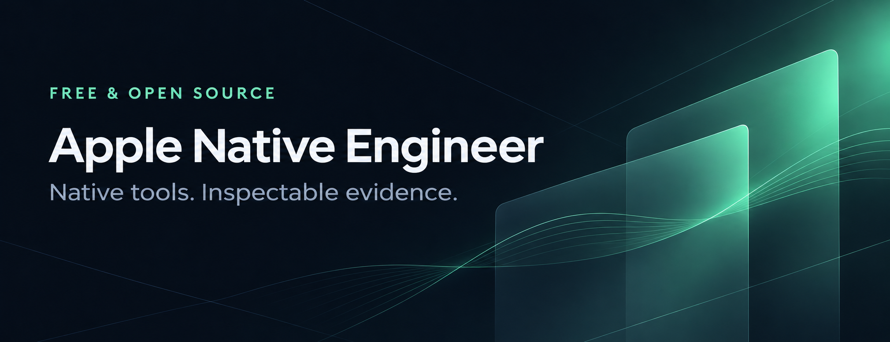
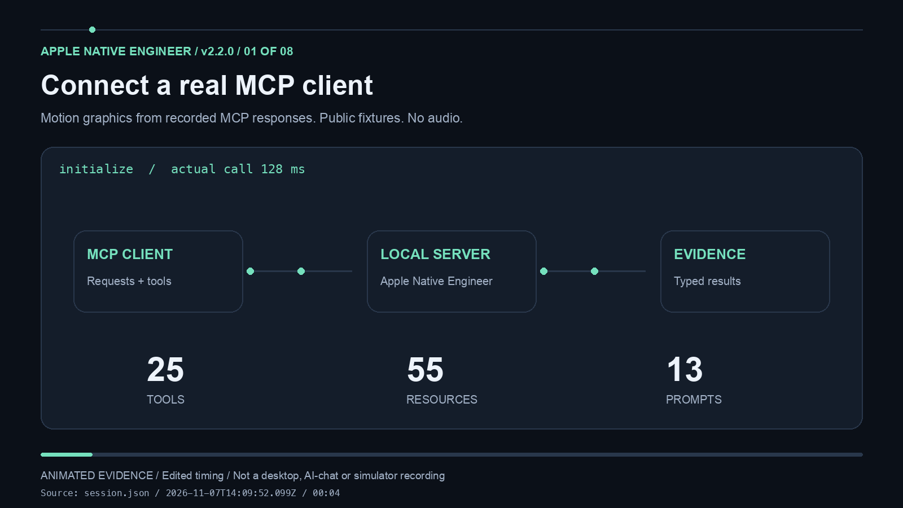
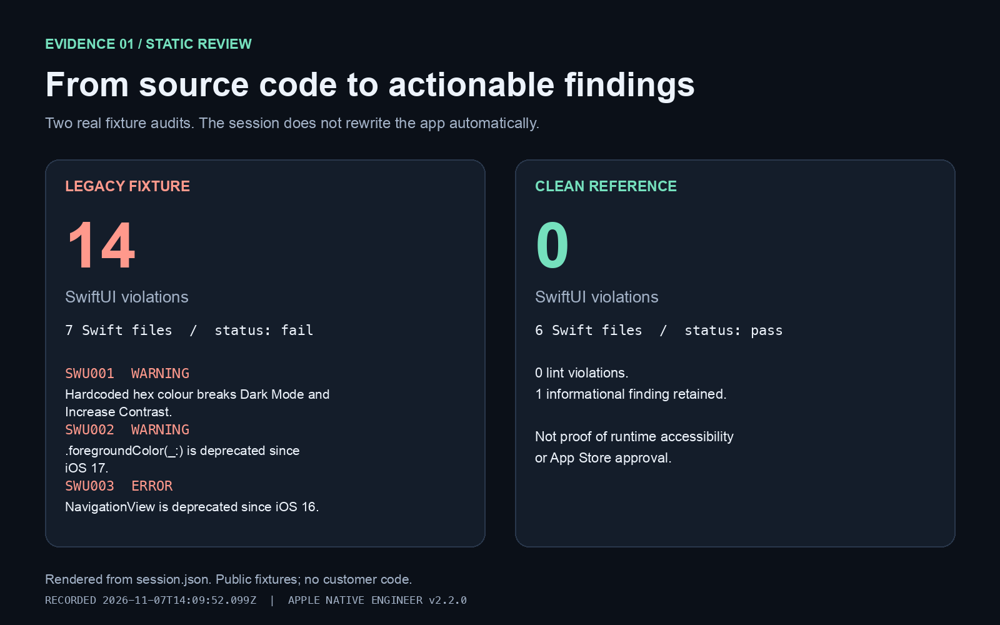
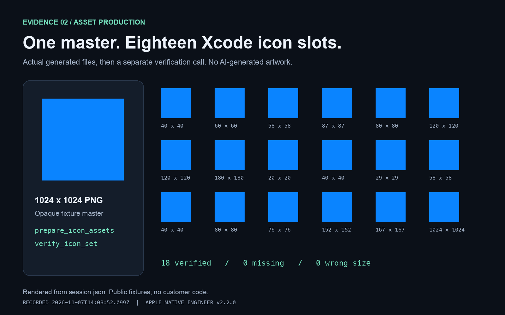
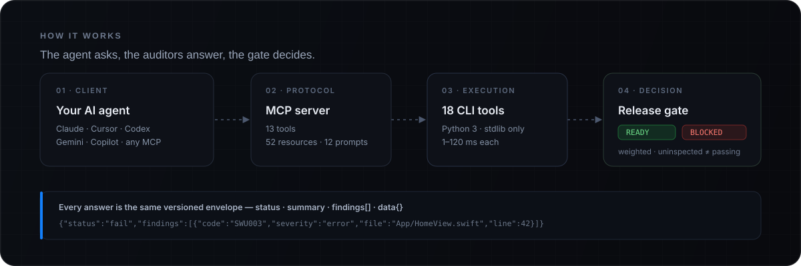

<p align="center">
  
</p>

<p align="center">
  <a href="https://github.com/kayaonur607/apple-native-engineer-mcp/releases"></a>
  <a href="https://github.com/kayaonur607/apple-native-engineer-mcp/actions/workflows/ci.yml"></a>
  
  <a href="LICENSE"></a>
</p>

<p align="center">
  <strong>An Apple development and design toolkit for your AI assistant.</strong><br>
  Research Apple APIs. Review SwiftUI. Generate and validate assets.<br>
  Turn release preparation into a traceable engineering workflow.
</p>

<p align="center">
  <a href="#watch-the-workflow">Watch the workflow</a> ·
  <a href="#install-from-github">Install</a> ·
  <a href="#what-you-can-do">Capabilities</a> ·
  <a href="#versions-and-automatic-updates">Updates</a> ·
  <a href="docs/PROOF.md">Verification evidence</a>
</p>

Apple Native Engineer connects a compatible MCP client to **25 MCP tools**, **55 resources** and **13 prompts**. It combines local Python checks, Apple documentation research and reusable engineering guidance. Your AI client supplies the model and writes the code; this server supplies tools and evidence.

**Completely free and open source under MIT. No paid tier, account or license key.**

Independent software. Not affiliated with, employed by, or endorsed by Apple. Static results do not guarantee App Store approval or runtime correctness.

## Watch the workflow

[](assets/demo/usage-demo.mp4)

**[Watch the 64-second usage video](assets/demo/usage-demo.mp4)** · [Animated preview](assets/demo/usage-preview.gif) · [Raw MCP session](assets/demo/session.json) · [Checksums](assets/demo/SHA256SUMS)

The video is an animated, captioned walkthrough built from **real stdio MCP requests and responses**. It shows connection and inventory discovery, developer/designer onboarding, project inspection, SwiftUI checks, icon production, asset verification and release notes. It has no audio. It uses animated signal flow, staged finding cards, an icon fan-out and moving validation indicators. It is an evidence-based motion graphic, not an AI chat or simulator screen recording.

The projects are public test fixtures. Legacy and clean are separate implementations; the comparison does not claim that the MCP automatically rewrote an application. The icon step does create real PNG files and `Contents.json`.

<details>
<summary>View the animated walkthrough here</summary>


</details>

## What you can do

| Your task | What the toolkit provides | What you get |
| --- | --- | --- |
| Understand an unfamiliar app | Project inspection and eight coordinated audits | Targets, deployment floors, architecture signals and attributed findings |
| Design a native screen | HIG research, reference guides and design workflows | Source-backed design decisions for the host AI to implement |
| Review SwiftUI changes | Lint, accessibility heuristics, Liquid Glass and diff review | Finding codes, severity, file/line and remediation hints |
| Check API compatibility | Apple symbol search, documentation and availability tools | Apple source URLs, retrieval timestamps and platform availability |
| Produce App Store assets | Icon generation/verification and screenshot composition | Xcode icon slots and marketing compositions around supplied captures |
| Prepare a listing | Metadata, ASO and App Store Review checks | Character budgets, risky claims and review findings |
| Prepare a release | Weighted release readiness report | A verdict, score and explicit uninspected or blocking items |

The toolkit contains **18 CLI tools**, **32 reference guides**, **12 checklists** and **9 worked examples**. Capabilities are grouped into eleven modules; disabled tools are absent from the connected inventory. See the [capability matrix](docs/ROADMAP.md) and [module controls](docs/MODULES.md).

## Evidence: source code → findings



`lint_swiftui` reports **14 violations across seven Swift files** in the legacy fixture. The clean reference reports **zero violations across six Swift files**, retaining one informational finding. These are two separate, real tool runs captured in [session.json](assets/demo/session.json).

The useful output is the evidence behind the status: a finding code, severity, source location, message and fix hint. The AI can use those findings to make a change, then call `review_diff` to check the changed files. Compiler, device and visual checks remain separate.

## Evidence: master artwork → Xcode assets



`prepare_icon_assets` converts one opaque **1024 × 1024 PNG** into **18 icon slots plus `Contents.json`**. `verify_icon_set` then reads the generated set and reports **18 verified, zero missing, zero wrong-size files** in this recorded run.

This is asset preparation from supplied artwork. It does not generate original icon artwork. The solid-colour master shown here is a test fixture, not a customer design or a finished brand asset.

## Install from GitHub

Requires **Git, Node 20+, npm and Python 3.10+**. Xcode is required for Apple builds and simulator work; the static auditors do not require it.

```bash
git clone https://github.com/kayaonur607/apple-native-engineer-mcp.git
cd apple-native-engineer-mcp
node scripts/setup-mcp.mjs
```

GitHub is the sole product distribution and release channel. npm installs the locked SDK dependencies; this product is not published to npm. No hosted service, developer account or AI API key is required for local static checks. Your MCP client may have its own model or subscription requirements.

Configure your MCP client with the **absolute path** to the launcher:

```json
{
  "mcpServers": {
    "apple-native-engineer": {
      "command": "node",
      "args": ["/absolute/path/apple-native-engineer-mcp/integrations/mcp-server/scripts/github-launcher.mjs"],
      "env": {
        "APPLE_NATIVE_PYTHON": "python3"
      }
    }
  }
}
```

Replace `/absolute/path` with your checkout location. First installation or an update can take several minutes. Prewarm the cache with `--selftest` before connecting clients with short startup timeouts. See the [complete installation and update guide](docs/UPDATES.md).

Client guides: [Claude Code](integrations/claude-code.md) · [Claude Desktop](integrations/mcp-server/README.md) · [Cursor](integrations/cursor.md) · [Codex](integrations/codex.md) · [GitHub Copilot](integrations/github-copilot.md) · [Gemini CLI](integrations/gemini-cli.md) · [OpenCode](integrations/opencode.md).

## Start with a goal

Use `/apple-native-start` in clients that expose MCP prompts, or describe the work naturally:

```text
I am an Apple developer and designer. Inspect this project and its deployment
versions, research the relevant HIG guidance, then improve the settings screen.
Show the findings and the checks you actually ran.
```

```text
Apple geliştiricisiyim ve tasarımcıyım. Önce projeyi ve hedef sürümlerini incele.
Ana ekranı Apple HIG kaynaklarına göre geliştir; değişikliklerden sonra gerçek
kontrolleri çalıştır ve kalan eksikleri açıkça belirt.
```

The workflow asks only for information needed to proceed, uses the user's language, researches API availability and distinguishes static checks from builds and runtime observations. The host client controls prompt discovery and execution; typing a sentence does not force every AI client to invoke a specific prompt.

### A typical development loop

1. **Inspect:** call `inspect_apple_project` to establish the actual project and deployment targets.
2. **Research:** retrieve the relevant Apple documentation and HIG pages; cite their returned URLs and timestamps.
3. **Implement:** let the host AI make the authorized code/design changes using the project and relevant connected tools.
4. **Review:** run `review_diff` for changed Swift files; investigate findings and false positives.
5. **Validate:** build and exercise the relevant UI when those capabilities are available. For release work, run `generate_release_report` and list remaining blockers.



## The tool inventory

| Area | MCP tools |
| --- | --- |
| Project and edit loop | `inspect_apple_project`, `audit_project`, `review_diff`, `check_environment` |
| SwiftUI and experience | `lint_swiftui`, `audit_accessibility`, `audit_liquid_glass`, `check_localization`, `validate_widgets` |
| Design system | `validate_sf_symbols`, `forge_design_tokens` |
| Apple research | `search_apple_documentation`, `read_apple_documentation`, `inspect_apple_api_availability`, `find_apple_guidelines` |
| Privacy and store review | `audit_privacy_manifest`, `audit_app_store_review`, `validate_app_metadata`, `analyze_app_store_optimization` |
| App Store assets | `validate_app_icon`, `prepare_icon_assets`, `verify_icon_set`, `compose_marketing_screenshots` |
| Release and account inspection | `generate_release_report`, `app_store_connect` |

`audit_project` combines eight existing auditors and attributes each finding to its producer. `review_diff` checks changed Swift files against the SwiftUI, accessibility and Liquid Glass auditors. Both use the same Python tools available directly from the CLI.

The local SF Symbols catalogue contains **9,649 symbols**, with per-platform availability data. Documentation tools contact Apple's documentation service when called. App Store Connect is read-only and requires your own credentials.

### Knowledge and workflows

| Surface | What the AI can read |
| --- | --- |
| `apple-native://skill` | The bundled engineering/design operating standard |
| `apple-native://release` | Installed version, release notes and update policy |
| `apple-native://references/<name>` | Relevant technical and design references |
| `apple-native://checklists/<name>` | Review and submission checklists |
| `apple-native://examples/<name>` | Worked implementation examples |

Thirteen prompts cover onboarding, design, code, review, privacy, icons, screenshots, Connect, metadata, widgets, localization and releases. External Figma, simulator, image or repository tools are used only when the host exposes them; this server does not bundle every third-party integration.

## Versions and automatic updates

**Current source version: v2.3.0.** See [CHANGELOG.md](CHANGELOG.md) for the version history and [GitHub Releases](https://github.com/kayaonur607/apple-native-engineer-mcp/releases) for published versions. A local tag or changelog entry is not a published release.

The GitHub launcher checks published stable releases **when the MCP process starts**. It stages the candidate in a separate version/commit directory, installs locked dependencies, validates its version and runs an inventory smoke test before atomically activating it.

- Existing sessions continue on their current version. Updates apply on reconnect/restart.
- Failed downloads or installations preserve the active cached version.
- Startup instructions ask the AI to announce its version and relevant changes; the client controls presentation.
- `APPLE_NATIVE_VERSION=mcp-v2.3.0` pins a published version or permits rollback.
- `APPLE_NATIVE_AUTO_UPDATE=off` disables the update check.
- Automatic updates include new stable major versions unless a version is pinned.

The bootstrap launcher is kept in your original checkout. Changes to the launcher itself require updating that checkout explicitly. Direct `node src/index.js` runs and separately copied skills do not gain automatic updates. Full details: [update policy and failure handling](docs/UPDATES.md).

## Verification and reproducibility

The local verification suite contains **209 tests: 131 Python tests and 78 MCP/Node tests**. The MCP tests include protocol calls, HTTP behaviour, module isolation, update staging, offline fallback, failed-install preservation, concurrent updates, version pins and telemetry sanitization.

```bash
./scripts/verify.sh
```

The recorded local run passed all five stages. Swift validation parsed **162 documented snippets**: **73 type-checked**, while **89 were classified as fragments**. Documentation checks verified 127 modifiers against the installed SDK and explicitly allowlisted two. A parse pass is not a full build of every example application.

Read the [verification transcript and limits](docs/PROOF.md). GitHub Actions reports the result of each pushed revision independently.

To regenerate the usage evidence and media:

```bash
node integrations/mcp-server/scripts/record-demo.mjs
python3 scripts/render-demo-media.py
```

The recorder uses a real MCP client over stdio. The renderer requires Pillow and ffmpeg **for media authoring only**. The MCP runtime does not depend on them. See the [media provenance and chapter guide](assets/demo/README.md).

## Privacy, permissions and boundaries

| Topic | Behaviour |
| --- | --- |
| Customer source | Local auditors read source and return findings to the configured client. The updater does not upload it. The client's own model/data policy is separate. |
| Network access | GitHub release checks/clones and locked dependency downloads during updates; Apple documentation and App Store Connect when called; optional telemetry only when enabled. |
| Writes | Icon, token, screenshot and report tools can write requested output files. Audit tools are read-only. App Store Connect operations are GET-only. |
| Telemetry | Off by default. Optional local/anonymous telemetry uses a closed five-field event schema; no source, paths or prompts. |
| Update trust | Stable releases published by this GitHub repository's maintainers. TLS, GitHub ownership and the lockfile are the trust boundary; publisher-signature verification is not implemented. |
| Hosted access | No public hosted service. An HTTP server sees its own filesystem; it cannot read a customer's laptop by receiving a local path. |

A static audit can miss defects and produce false positives. VoiceOver traversal, Dynamic Type layouts, motion, Dark Mode, RTL and device-specific behaviour need actual runtime review. Only Apple can approve an App Store submission. No revenue, time-saving or customer performance claim is implied by fixture results.

Read [SECURITY.md](SECURITY.md) for the threat model and reporting process.

## Documentation and contribution

[Operating standard](SKILL.md) · [Architecture](docs/ARCHITECTURE.md) · [Platform workflow](docs/PLATFORM-WORKFLOW.md) · [Ecosystem](docs/ECOSYSTEM.md) · [Brand assets](docs/BRANDING.md) · [Capability roadmap](docs/ROADMAP.md) · [Release procedure](docs/PUBLISHING.md) · [Free user pilot](docs/COMMERCIAL-LAUNCH.md) · [Open-source portfolio workflow](docs/OPEN-SOURCE.md) · [Contributing](CONTRIBUTING.md).

New checks should include a finding code, a defect fixture and regression coverage. Keep claims tied to reproducible evidence. Run `./scripts/verify.sh` before proposing a release.

[MIT License](LICENSE). Apple, Swift, SwiftUI and related marks belong to their respective owners.

## Runtime and external-project evidence

The controlled SwiftUI sample was compiled and launched in an actual iOS simulator. [Light screenshot](assets/runtime-proof/light.png) · [Dark screenshot](assets/runtime-proof/dark.png) · [Commands and scope](assets/runtime-proof/evidence.json). These captures do not certify VoiceOver or customer app behaviour.

[Apple Food Truck audit](assets/validation/food-truck.json) records an external project and its exact commit. Findings have not been independently classified, so no precision or recall claim is made.

[Apple Backyard Birds audit](assets/validation/backyard-birds.json) adds a second pinned external source corpus. These external scans do not certify the applications or establish overall detector accuracy.
