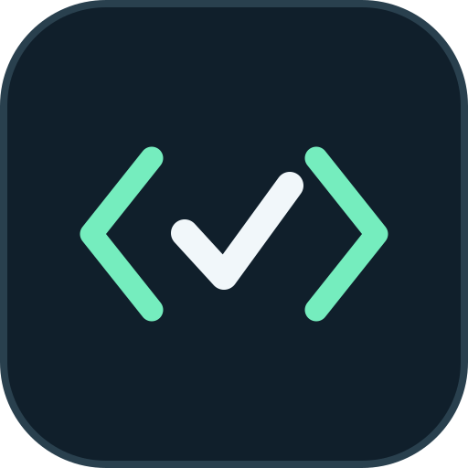
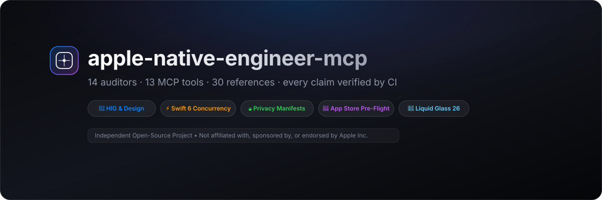
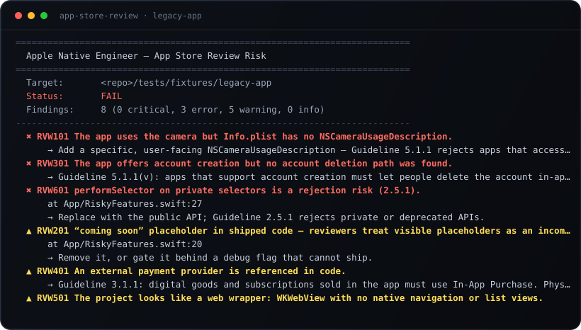

<p align="center">
  
</p>

<p align="center">
  
</p>

<p align="center">
  <a href="https://github.com/kayaonur607/apple-native-engineer-mcp/actions/workflows/ci.yml"></a>
  
  <a href="LICENSE"></a>
  
  
  
</p>

<p align="center">
  <strong>AI writes iOS apps that compile and still look wrong.</strong><br>
  Hardcoded colours that vanish in Dark Mode, fixed font sizes that break Dynamic Type, deprecated navigation,<br>
  fake glass, missing privacy manifests. This project turns Apple's rules into checks an agent has to pass.
</p>

<p align="center">
  <sub>
  <b>181 tests</b> · <b>5/5 CI stages</b> · <b>162 snippets compiled</b> · <b>129 API claims checked against the SDK</b> · <b>9,649 SF Symbols</b> · <b>25 MCP tools</b><br>
  every number produced by <code>./scripts/verify.sh</code> — see <a href="#proof">Proof</a> and <a href="docs/PROOF.md">docs/PROOF.md</a>
  </sub>
</p>

---

## Install

```bash
npx -y apple-native-engineer-mcp --selftest   # 25 tools, 53 resources, 12 prompts
npx -y apple-native-engineer-mcp --doctor     # Node, Python, Xcode, SDK, auditors
```

That is the whole setup for an MCP client: point it at `npx apple-native-engineer-mcp` and nothing else. No clone,
no Python install, no credentials. Prefer a checkout? `git clone`, `cd integrations/mcp-server && npm install`.

<details>
<summary><b>Client configuration and the other entry points</b></summary>

```json
{
  "mcpServers": {
    "apple-native-engineer": {
      "command": "npx",
      "args": ["-y", "apple-native-engineer-mcp"]
    }
  }
}
```

As an agent skill (no server, no tools): `npx skills add kayaonur607/apple-native-engineer-mcp`.

As a CLI on any machine with Python 3.10+: `python3 tools/swiftui-linter/lint_swiftui.py .`

</details>

---

## What this actually is

**One MCP server that refuses to let an agent declare an Apple app finished without evidence.** Three layers, in
the order you meet them:

**1. An MCP server.** Twenty-five tools over stdio or Streamable HTTP: project inspection, one-call audits, diff
review, SwiftUI lint, accessibility, Liquid Glass, SF Symbols, privacy manifests, widgets, metadata, assets and a
weighted release gate. Every result is a typed envelope with finding codes — not prose.

**2. Eighteen auditors.** The Python CLI behind those tools. They run without Xcode, without a build, in
milliseconds, and a human can run the exact same command the agent runs. One implementation, so the agent and the
terminal can never disagree.

**3. A standard.** [`SKILL.md`](SKILL.md) plus 31 reference guides: what "native" means, which APIs are legacy,
what to refuse. The server enforces the parts that can be checked; the skill explains the parts that need judgment.

Capabilities are grouped into **eleven modules** you enable one by one (`APPLE_NATIVE_MODULES`), so a SwiftUI
developer never installs the App Store Connect credential path. What is implemented, partial and not started is
listed in [`docs/ROADMAP.md`](docs/ROADMAP.md).

> [!IMPORTANT]
> Every number on this page is produced by `./scripts/verify.sh`: 151 tests, a link and count validator, a real
> Swift compile of the fixtures, and a type-check of all documented snippets. See [Proof](#proof).

---

## The failure this fixes

Ask a model for an iOS settings screen. You get something like this — and it compiles:

```swift
Text("Account")
    .foregroundColor(Color(hex: "#8E8E93"))   // invisible in Dark Mode, and not a real API
    .frame(width: 320)                        // truncates at AX3 text sizes
Button { save() } label: { Image(systemName: "checkmark") }
    .frame(width: 30, height: 30)             // half the 44pt minimum tap target
```

Nothing in that snippet fails the build. The bugs live where a compiler does not look: contrast ratios, Dynamic
Type, hit targets, localisation, platform availability.

Three specific failure modes this repository removes:

| Failure | What it looks like in practice | What stops it |
| :--- | :--- | :--- |
| **Invented API** | `.spring(response: dampingRatio:)` — a label SwiftUI does not have. Looks plausible, does not compile. | 96 documented modifiers verified against 21,998 SDK symbols |
| **Invisible breakage** | A colour that works in Light Mode and disappears in Dark; text that clips at accessibility sizes. | WCAG maths and Dynamic Type rules, with the number in the finding |
| **False completion** | "Done — the settings screen is finished." No evidence, no gate, no verdict. | A release gate that returns `BLOCKED` instead of a compliment |

---

## How it works

<p align="center">
  
</p>

The agent asks in natural language. The server maps that to a script, the script produces a **finding list**, and
every finding carries a stable code, a severity, a file and line, a fix hint and a documentation link. The release
gate reads all of them and returns one of two answers.

There is deliberately **one implementation**: the MCP tools shell out to the same CLI this README documents. No
second code path, no drift between "what the agent runs" and "what a human runs".

---

## Quickstart

```bash
git clone https://github.com/kayaonur607/apple-native-engineer-mcp.git
cd apple-native-engineer-mcp

make doctor   # is this machine ready? (Python, Node, Xcode, SDK)
make demo     # 30 seconds: the audits on a deliberately broken app
make verify   # everything CI runs, including 181 tests and a real Swift compile
```

What `make demo` shows, trimmed:

```
1/4 · What is this project?            → iOS 16 floor, no @Observable, NavigationView, no tests
2/4 · What is wrong with the SwiftUI?  → 14 findings, 3 of them errors
3/4 · Would the App Store accept it?   → icon is 512×512 with alpha — rejected
4/4 · The verdict                      → BLOCKED, 19/100
```

Then the same gate on a project that follows the rules: **READY FOR SUBMISSION, 100/100**.

### Use it as an MCP server (recommended)

```bash
cd integrations/mcp-server && npm install
node src/index.js --selftest   # 16 tools · 53 resources · 12 prompts
```

Or without cloning anything:

```bash
npx -y apple-native-engineer-mcp --selftest
```

For a shared endpoint or a container, the same server speaks Streamable HTTP:
`node src/index.js --http` serves `POST /mcp` plus a `GET /health` probe, loopback-bound and origin-checked by
default.

```json
{
  "mcpServers": {
    "apple-native-engineer": {
      "command": "node",
      "args": ["/absolute/path/to/apple-native-engineer-mcp/integrations/mcp-server/src/index.js"]
    }
  }
}
```

Add that to `claude_desktop_config.json` or `.cursor/mcp.json`. Details: [`integrations/`](integrations/).

### Use it as a skill (no server)

```bash
npx skills add kayaonur607/apple-native-engineer-mcp
```

### Use the CLI directly (no AI at all)

```bash
python3 tools/project-inspector/inspect_project.py .
python3 tools/swiftui-linter/lint_swiftui.py .
python3 tools/release-readiness/generate_report.py . --metadata metadata.json --icon AppIcon-1024.png
```

Python 3.10+, standard library, nothing to install. Every tool supports `--json`, `--strict` and `--color`.

---

## What it catches

Eighteen auditors, 100+ finding codes. The ones that matter most:

| Area | Example finding | Tool |
| :--- | :--- | :--- |
| **SwiftUI correctness** | `.foregroundColor` deprecated, `NavigationView`, `onChange(of:perform:)`, `AnyView` in rows | [`swiftui-linter`](tools/swiftui-linter/) |
| **Accessibility** | `#C7C7CC` on white is **1.68:1** (needs 4.5:1); 30pt tap target; unlabelled icon button | [`accessibility-auditor`](tools/accessibility-auditor/) |
| **Liquid Glass** | iOS 26 `glassEffect` on an iOS 17 target without a guard; `.ultraThinMaterial` + `.blur` imitation | [`liquid-glass-auditor`](tools/liquid-glass-auditor/) |
| **SF Symbols** | A symbol that does not exist (with the three closest real names), or one newer than your deployment target | [`sf-symbols-catalog`](tools/sf-symbols-catalog/) |
| **Privacy** | Required-Reason API used but undeclared, or declared with a reason code Apple does not accept | [`privacy-auditor`](tools/privacy-auditor/) |
| **Localisation** | `Text(verbatim:)`, UIKit strings that are never looked up, `.padding(.left)` that ignores RTL | [`localization-checker`](tools/localization-checker/) |
| **Widgets** | Missing Dynamic Island regions, no `NSSupportsLiveActivities`, no `supportedFamilies` | [`widget-validator`](tools/widget-validator/) |
| **App Store assets** | Icon is 512×512, or has an alpha channel, or screenshots match no accepted slot | [`asset-validator`](tools/asset-validator/) |
| **Release decision** | Seven weighted gates; a gate with no input is `NOT INSPECTED` → `BLOCKED` | [`release-readiness`](tools/release-readiness/) |

The complete list, with finding codes and exit codes, is in the [tool table](#the-18-cli-tools).

<p align="center">
  
</p>

<p align="center"><sub>Not a mock-up: the card is rendered from the command's own output — <code>python3 tools/app-store-review/review.py tests/fixtures/legacy-app</code> — by <code>scripts/render_terminal_card.py</code>. Regenerate with <code>make evidence</code>.</sub></p>

---

## Design rules it enforces

These are the rules that separate "looks like iOS" from "is iOS":

| Never | Always | Enforced by |
| :--- | :--- | :--- |
| Hardcoded hex, `Color.white` | Semantic colours, asset colours, `.primary` | `SWU001`, `SWU013`, `A11Y001` |
| `.font(.system(size:))` | Text styles that scale with Dynamic Type | `SWU012`, `A11Y010` |
| `.frame(width:)` on text | `.frame(maxWidth:)`, `ViewThatFits`, layout priority | `SWU005` |
| `scaleEffect(0)` | Springs from 0.9–0.95 | `SWU009` |
| `.ultraThinMaterial` + `.blur` | `.glassEffect(_:in:)` on iOS 26+, behind `#available` | `LG001`, `LG010` |
| `.padding(.left)` | `.padding(.leading)` / `.horizontal` | `L10N010` |
| An icon with alpha | Opaque 1024×1024 PNG | `ASSET004` |
| A privacy manifest from memory | `PrivacyInfo.xcprivacy` with valid reason codes | `PRIV001`, `PRIV010` |

---

## The 18 CLI tools

| Tool | The question it answers | Codes |
| :--- | :--- | :--- |
| [`project-inspector`](tools/project-inspector/) | What is this project, what does it target, what debt does it carry? | `PROJ*` |
| [`privacy-auditor`](tools/privacy-auditor/) | Are Required-Reason APIs declared with **valid** reason codes? | `PRIV*` |
| [`asset-validator`](tools/asset-validator/) | Is the icon an opaque 1024×1024 PNG, and do screenshots match a slot? | `ASSET*` |
| [`metadata-validator`](tools/metadata-validator/) | Does the listing fit App Store Connect's character limits? | `META*` |
| [`localization-checker`](tools/localization-checker/) | Which strings can never be translated, and what breaks in RTL? | `L10N*` |
| [`widget-validator`](tools/widget-validator/) | Do the widget, Dynamic Island and Live Activity actually work? | `WID*` |
| [`swiftui-linter`](tools/swiftui-linter/) | 20 rules: deprecated API, hardcoded styling, identity churn. | `SWU*` |
| [`accessibility-auditor`](tools/accessibility-auditor/) | Real WCAG contrast maths, Dynamic Type, 44pt targets, VoiceOver. | `A11Y*` |
| [`liquid-glass-auditor`](tools/liquid-glass-auditor/) | Liquid Glass adopted correctly — or imitated with fake stacks? | `LG*` |
| [`sf-symbols-catalog`](tools/sf-symbols-catalog/) | Does this symbol exist, and does it exist on *your* deployment target? | `SFC*` |
| [`design-token-forge`](tools/design-token-forge/) | Token JSON → SwiftUI tokens + `.xcassets`, with contrast checks. | `TOK*` |
| [`screenshot-studio`](tools/screenshot-studio/) | Capture from a simulator, compose marketing frames, validate the slot. | `SHOT*` |
| [`app-store-connect`](tools/app-store-connect/) | Read-only ASC: apps, versions, builds, listing copy, screenshot sets. No silent mock. | `ASC*` |
| [`release-readiness`](tools/release-readiness/) | Weighted verdict across every gate — the only one that blocks. | `REL*` |
| [`apple-docs-research`](tools/apple-docs-research/) | What does Apple actually say, and on which OS does this API exist? | `DOC*` |
| [`app-store-review`](tools/app-store-review/) | Which guideline would a reviewer cite, and where is the evidence? | `RVW*` |
| [`aso-engine`](tools/aso-engine/) | Which characters are wasted, which claims are risky, what should the keywords be? | `ASO*` |
| [`icon-studio`](tools/icon-studio/) | One 1024 master → 18 valid slots, verified; or preview it small. | `ICON*` |

**What is genuinely different here**, compared with the usual "Apple docs RAG" MCP server:

- **SF Symbol availability from the real catalogue.** 9,649 symbols extracted from `CoreGlyphs.bundle`, each mapped
  to the OS release that introduced it. The tool tells you whether a symbol exists on *your* deployment target and
  suggests the closest real name when you typo.
- **Liquid Glass detection, verified against the SDK.** The auditor knows `.glassEffect(_:in:)`,
  `GlassEffectContainer`, `.glassEffectID`, `.scrollEdgeEffectStyle` and `.buttonStyle(.glass)` are iOS 26+, that
  `Glass` has exactly `.regular`, `.clear`, `.identity` with `.tint()` and `.interactive()`, and that the API is
  unavailable on visionOS.
- **A release gate that cannot be fooled.** A gate with no input is `NOT INSPECTED`, scores zero and forces
  `BLOCKED`. A missing metadata file is not a passing metadata file.
- **Contrast maths, not contrast guesses.** Every ratio is computed from the WCAG relative luminance formula, in
  both appearances, and printed as a number.

---

## The 25 MCP tools

`audit_project` · `review_diff` · `check_environment` · `inspect_apple_project` · `audit_privacy_manifest` ·
`validate_app_icon` · `validate_app_metadata` · `check_localization` · `validate_widgets` · `lint_swiftui` ·
`audit_accessibility` · `audit_liquid_glass` · `validate_sf_symbols` · `forge_design_tokens` ·
`generate_release_report` · `app_store_connect` · `search_apple_documentation` · `read_apple_documentation` ·
`inspect_apple_api_availability` · `find_apple_guidelines` · `prepare_icon_assets` · `verify_icon_set` ·
`analyze_app_store_optimization` · `compose_marketing_screenshots` · `audit_app_store_review`

Two of them change how an agent works rather than just what it can check:

- **`audit_project`** runs eight audits concurrently and returns one envelope where every finding is tagged with
  the audit that produced it. One call instead of eight round trips.
- **`review_diff`** reads `git diff`, keeps the changed Swift files and audits only those. It is the tool for an
  edit loop: seconds instead of a full sweep, and findings grouped by file.

Neither is a second implementation — both compose the same scripts the CLI runs.

Built on the official `@modelcontextprotocol/sdk` (v1.32) rather than a hand-rolled JSON-RPC loop. That buys:

- **Structured output.** Every result carries a versioned envelope — `schema_version`, `status`, `summary`,
  `findings[]`, `data{}` — validated against a declared `outputSchema`, so clients get typed fields.
- **Honest errors.** A missing path returns `isError: true` with a machine-readable code, never a stack trace.
- **53 resources.** The 31 guides, 12 checklists, 9 examples and `SKILL.md`, addressable as `apple-native://`
  URIs. The agent loads the design standard on demand instead of you pasting it into the prompt.
- **12 prompts.** Every slash command (`/apple-native`, `/apple-native-design`, `/apple-native-release`, …) is a
  first-class MCP prompt with a `project` argument and an optional `focus`.
- **Read-only annotations.** Audit tools are `readOnlyHint: true, destructiveHint: false`. The server cannot mutate
  your project or your App Store account.
- **Capability modules.** Nine modules, enabled with `APPLE_NATIVE_MODULES`. A SwiftUI developer never installs the
  App Store Connect credential path; a privacy reviewer can run `core,privacy-security-audit` and nothing else. A
  disabled tool is absent from `tools/list` and returns an error if called — never a silent empty result. See
  [`docs/MODULES.md`](docs/MODULES.md).
- **No data collection.** No audit makes a network call. Telemetry is off by default; when you turn it on it records
  five fields — tool, outcome, duration bucket, day, schema — and an allowlist drops everything else.
  `--telemetry-preview` prints the exact bytes, and a test feeds it paths and prompts to prove they do not survive.

---

## The knowledge base

| Section | Count | What is in it |
| :--- | ---: | :--- |
| [`SKILL.md`](SKILL.md) | — | The operating standard: decision tables, refusal rules, definition of done |
| [`references/`](references/) | 31 reference guides | HIG, Liquid Glass, SwiftUI, StoreKit 2, SwiftData, privacy, performance, visionOS |
| [`checklists/`](checklists/) | 12 checklists | Review protocols for a PR, a design review or a submission |
| [`examples/`](examples/) | 9 worked examples | Navigation, adaptive layout, animation, Live Activities, paywalls |
| [`commands/`](commands/) | 12 commands | Slash-command specs that drive the tools |

Written against **iOS 26 / 27 and macOS 26 / 27**, with an iOS 17 floor for code that has to run on older devices.
Liquid Glass, `@Observable`, Swift Testing and String Catalogs are the defaults; `NavigationView`,
`ObservableObject`, `foregroundColor` and fixed font sizes are called out as legacy.

`references/whats-new-ios-27.md` is generated from the installed SDK, not recalled: every row is a declaration the
compiler sees annotated `@available(iOS 27.0, …)`.

---

## Proof

Most repositories describe. This one measures. `./scripts/verify.sh` runs five stages and fails if any of them
disagrees with the documentation:

| Stage | Result | How it is measured |
| :--- | :--- | :--- |
| Repository validation | **pass** | Frontmatter, 20 required paths, every internal link, and every count in this README cross-checked against the filesystem |
| Python tests | **120 pass** | `python3 -m unittest` across 3.10 / 3.12 / 3.13 in CI |
| MCP protocol tests | **61 pass** | A real `Client` ↔ `McpServer` pair over the SDK's in-memory transport, a real HTTP socket, a throwaway git repo, the publish metadata, and hostile telemetry payloads |
| Swift compilation | **pass** | `swiftc -typecheck` on both fixtures, `swiftc -parse` on all 162 documented snippets, and a full type-check of 73 of them against the SDK each one targets — iOS or visionOS |
| Apple documentation | **live** | Search, read, availability and HIG pages fetched from developer.apple.com with a source URL and fetch time |
| Documentation claims | **pass** | 129 taught modifiers looked up in 21,998 SDK symbols; 64 iOS 27 declarations generated from the SDK |

Both directions are tested, which is the point:

- the **clean** fixture must produce **zero** findings across all auditors (no false positives)
- the **legacy** fixture must trip **every** rule it was built for (no false negatives)

`docs/PROOF.md` holds the raw terminal transcripts, including the check that found 14 occurrences of an invalid
`dampingRatio:` argument label across six guides.

### How a claim gets into this repository

1. It is written as a rule, a docstring or a reference guide.
2. A tool implements it and emits a stable finding code.
3. A fixture reproduces the defect and a test asserts the code fires.
4. CI runs the test on every push.

If a rule cannot survive step 3, it does not ship.

---

## Performance

The audits run before a build exists, so they must cost less than the thing they check. Measured with
`make benchmark` on a synthetic 500-file / 7,500-line project:

| Tool | Wall time |
| :--- | ---: |
| project-inspector | 82 ms |
| privacy-auditor | 107 ms |
| swiftui-linter | 88 ms |
| accessibility-auditor | 76 ms |
| localization-checker | 116 ms |
| liquid-glass-auditor | 78 ms |
| sf-symbols-catalog | 80 ms |
| release-readiness (runs the suite internally) | 317 ms |
| **all eight** | **922 ms** |

≈123 ms per 1,000 lines of Swift for the whole suite. No network, no Xcode, no build products — cheap enough to run
on every agent turn instead of once a day in CI.

---

## Compatibility

| | Supported |
| :--- | :--- |
| OS targets | iOS 17–27, iPadOS, macOS 14–27, watchOS 10+, visionOS 1+ |
| Language | Swift 6.x (the tools also audit Swift 5-mode projects) |
| Xcode | 26+ for the Liquid Glass checks; the Python tools need no Xcode at all |
| Python | 3.10, 3.12, 3.13 (standard library only) |
| Node | 20, 22 (MCP server) |
| Clients | Claude Desktop, Claude Code, Cursor, Codex, GitHub Copilot, Gemini CLI, OpenCode, any MCP client |

### Optional: live App Store Connect

Read-only, and it refuses to pretend:

```bash
export ASC_KEY_ID=XXXXXXXXXX
export ASC_ISSUER_ID=00000000-0000-0000-0000-000000000000
export ASC_PRIVATE_KEY_PATH=~/.appstoreconnect/AuthKey_XXXXXXXXXX.p8
python3 -m pip install cryptography      # required for ES256 signing

python3 tools/app-store-connect/cli.py verify
```

No credentials? A hard error that names the missing variables. `--mock` exists, is explicit, and says so in its
output. There is no silent fallback to synthetic data.

---

## Non-goals

- **Not a build system.** It never runs `xcodebuild` to produce your app; it checks what breaks *before* and
  *after* the build.
- **Not a documentation search engine.** Apple's docs are better at being Apple's docs. This is opinionated
  engineering review.
- **Not a code generator.** `design-token-forge` emits tokens, not screens.
- **Not official.** Independent project, MIT licensed, not affiliated with or endorsed by Apple. Apple's
  guidelines are referenced for interoperability under nominative fair use.

---

## Repository layout

```
apple-native-engineer-mcp/
├── SKILL.md                     # the standard an agent loads first
├── tools/                       # 18 CLI tools
│   └── lib/apple_native/        #   shared report contract, Swift scanner, colour maths, Xcode parser
├── integrations/mcp-server/     # official-SDK MCP server (tools + resources + prompts)
├── references/  checklists/  examples/  commands/
├── data/sf-symbols.json         # 9,649 SF Symbols with per-OS availability
├── tests/                       # 87 Python tests + two fixture projects
├── scripts/                     # verify, doctor, demo, benchmark, generators
├── docs/PROOF.md                # raw verification transcripts
├── docs/PUBLISHING.md           # release runbook: version, tag, npm, registries
└── .github/workflows/ci.yml     # repository · python ×3 · mcp · swift
```

---

## Security

| Question | Answer |
| :--- | :--- |
| Does it upload my source? | No. Audit tools read files locally and print JSON to stdout. |
| What talks to the network? | Only two things, and only when called: `developer.apple.com` (documentation research) and `api.appstoreconnect.apple.com` (read-only App Store Connect). |
| How are credentials stored? | `ASC_*` environment variables or a `.p8` path for App Store Connect; the macOS app keeps assistant keys in the Keychain. Never in tool results, never in logs. |
| Telemetry? | Off by default. `APPLE_NATIVE_TELEMETRY=local` or `anonymous` writes a closed five-key event; a test feeds the sanitiser hostile payloads and fails if anything else escapes. `--telemetry-preview` prints the exact bytes first. |
| Can a tool modify my account? | Not today: the App Store Connect client only issues GET requests. Any write capability would arrive as its own module with a preview → approve → apply → read-back flow. |
| What about secrets in the repo? | `.env`, `*.p8`, `*.pem` are git-ignored; documentation is validated for leaked personal paths in CI. |

The full threat model and reporting process are in [SECURITY.md](SECURITY.md). Modules let you disable the
network-facing capabilities entirely: `APPLE_NATIVE_MODULES=core,swift-engineering`.

---

## Contributing

New rules need three things: a finding code, a fixture that reproduces the defect, and a test that proves the code
fires — plus one that proves the clean fixture stays silent. See [CONTRIBUTING.md](CONTRIBUTING.md).
`./scripts/verify.sh` is the gate.

## License

[MIT](LICENSE) © apple-native-engineer-mcp contributors
