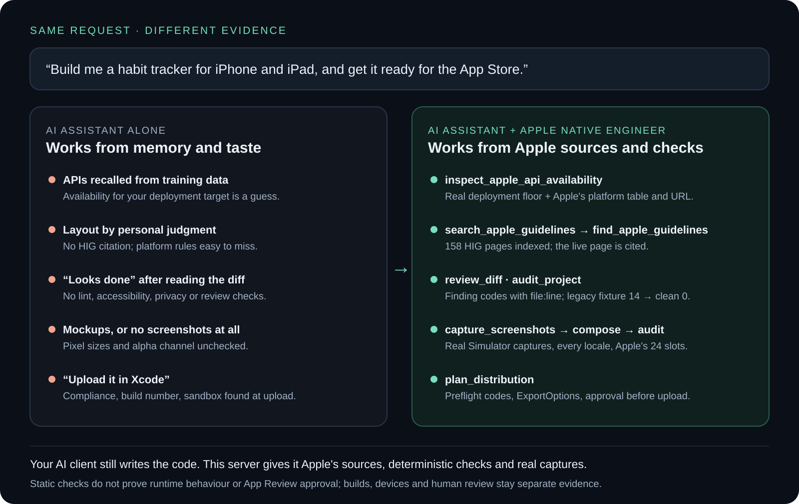
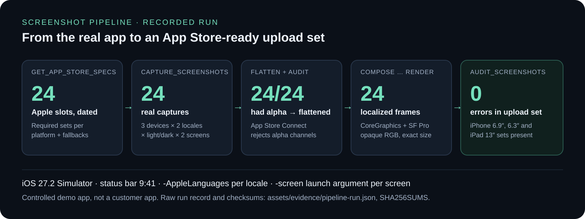
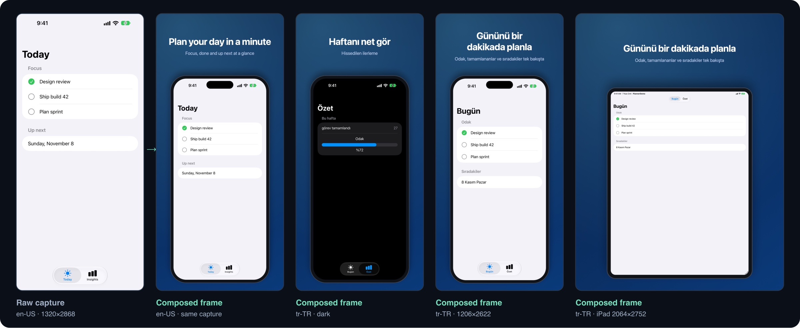
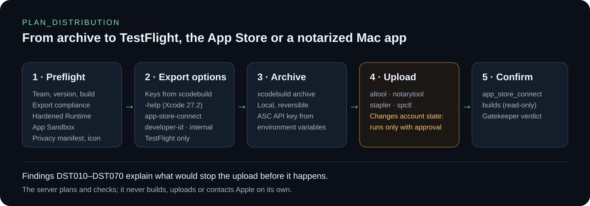
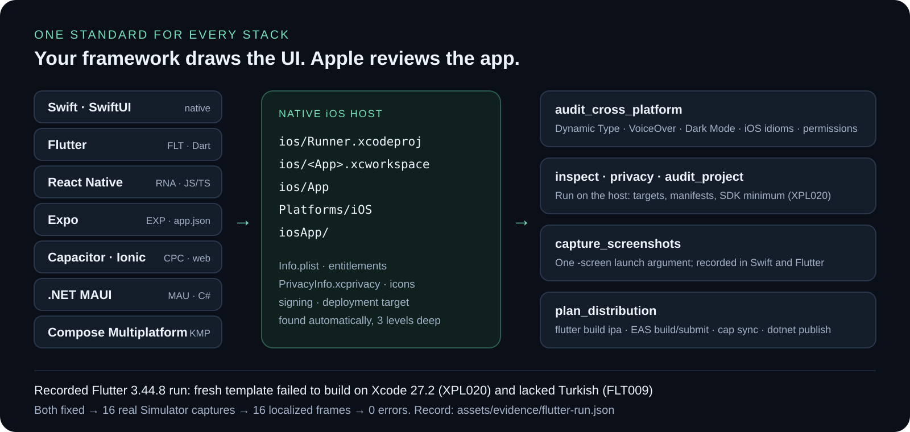
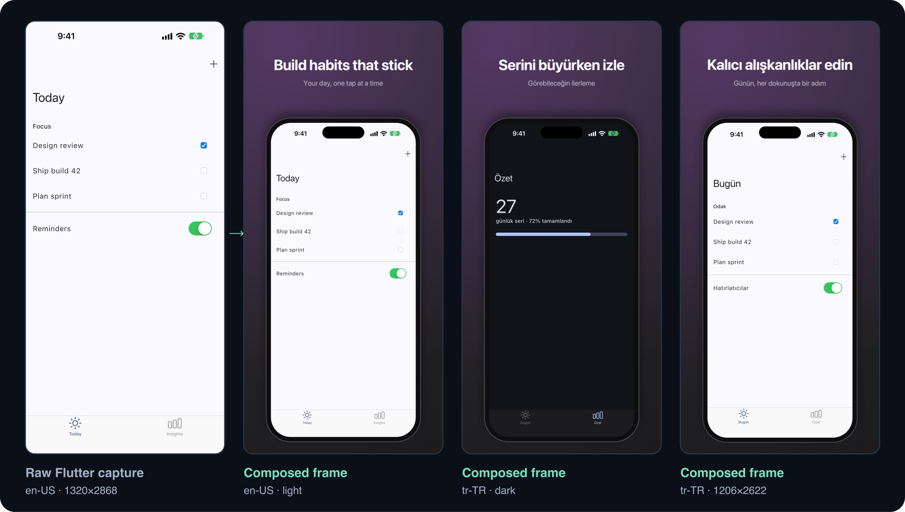

<p align="center">
  
</p>

<p align="center">
  <a href="https://github.com/kayaonur607/apple-native-engineer-mcp/releases"></a>
  <a href="https://github.com/kayaonur607/apple-native-engineer-mcp/actions/workflows/ci.yml"></a>
  
  
  
  <a href="LICENSE"></a>
</p>

<p align="center">
  <strong>Give your AI assistant Apple's sources, Apple's rules and a real Simulator.</strong><br>
  Design with the Human Interface Guidelines. Verify SwiftUI. Capture and frame App Store screenshots.<br>
  Plan TestFlight, App Store and notarized releases — with evidence for every step.<br>
  Swift, Flutter, React Native, Expo, Capacitor, .NET MAUI or Kotlin Multiplatform.
</p>

<p align="center">
  <a href="#why-not-just-ask-your-ai">Why</a> ·
  <a href="#what-people-use-it-for">Use cases</a> ·
  <a href="#evidence">Evidence</a> ·
  <a href="#cross-platform-apps">Cross-platform</a> ·
  <a href="#install">Install</a> ·
  <a href="#start-with-a-goal">Prompts</a> ·
  <a href="#tools">Tools</a> ·
  <a href="docs/PROOF.md">Verification</a>
</p>

Apple Native Engineer is an [MCP](https://modelcontextprotocol.io) server. It connects Claude, Cursor, Codex,
Copilot, Gemini CLI or any MCP client to **31 MCP tools**, **25 prompts** and **64 resources** for Apple-platform
design and engineering — whether the app is written in Swift or in Flutter, React Native, Expo, Capacitor, .NET MAUI
or Kotlin Multiplatform. Your AI still writes the code; this server gives it what a model cannot know from training
data alone — your project's real deployment targets, Apple's current documentation and guidelines, deterministic
checks, real Simulator captures and the exact distribution commands for the installed Xcode.

**Completely free and open source under MIT. No paid tier, account or license key.**
Independent software — not affiliated with or endorsed by Apple. Static results do not guarantee App Store approval.

---

## Why not just ask your AI?

You can type *“build me this app”* into any assistant. It will produce code. The difference is what that code is
based on and what proves it works.



| You ask for… | AI alone | AI + Apple Native Engineer | Proof in this repository |
| --- | --- | --- | --- |
| “Use the newest SwiftUI API” | Recalls APIs from training data; may target an OS your project does not support | Reads your deployment floor, then checks each API in Apple's availability table and cites the URL | `inspect_apple_api_availability` · [tests](tests/test_apple_docs.py) |
| “Make it feel native” | Designs by taste | Finds the right page among **158 HIG pages**, reads it live, applies platform rules (tvOS focus, iPhone Duo side bars, visionOS ornaments) | [`data/hig-catalog.json`](data/hig-catalog.json) · [platform references](#platform-coverage) |
| “Is the code good?” | Re-reads its own diff | Runs lint, accessibility, Liquid Glass, privacy and localization auditors with finding codes and file:line | [Legacy fixture: 14 violations → clean: 0](#swiftui-audit) |
| “Make App Store screenshots” | Mockups, or instructions | Captures the **real app** in the Simulator per device × language × appearance, flattens alpha, frames it natively, audits against Apple's slots | [24 recorded captures → 24 frames, 0 errors](#screenshot-pipeline) |
| “Make my Flutter / React Native app feel like iOS” | Generic advice for the framework | Finds the framework and its iOS host; checks Dynamic Type, VoiceOver, Dark Mode, iOS idioms, permissions, Xcode languages and the SDK's minimum target | [Recorded Flutter run: template build failure found and fixed](#cross-platform-apps) |
| “Ship it to TestFlight” | “Archive and upload in Xcode” | Preflights compliance, build number, sandbox and entitlements; writes ExportOptions from `xcodebuild -help`; asks before upload | [`plan_distribution`](#distribution) |

Use it when you want an assistant that **checks** instead of guessing — for a new app, an existing codebase, a
redesign, store assets or a release.

## What people use it for

| You are… | Typical request | What the server contributes |
| --- | --- | --- |
| **Developer** with an idea | “Build a habit tracker for iPhone and iPad.” | Platform prompts, HIG research, verified APIs, review loop on every change |
| **Flutter / React Native / Expo developer** | “Make this app feel native on iPhone and ship it.” | `audit_cross_platform`, framework prompts, `flutter build ipa` or EAS plans, the same Simulator screenshot pipeline |
| **Developer** with an existing app | “Audit this project and fix what blocks the next release.” | `audit_project` (8 auditors), `generate_release_report`, attributed findings |
| **Designer** | “Redesign the settings screen to Apple's standard, light and dark.” | HIG pages with URLs, design review prompt, captures of the result in every appearance |
| **Indie publisher** | “Make my App Store screenshots in English, Turkish and German.” | Simulator capture plan, localized captions, native frames at exact sizes, upload-set audit |
| **Team lead / CI** | “Set up internal TestFlight builds for pull requests.” | ExportOptions with `testFlightInternalTestingOnly`, ordered commands, credential hygiene |
| **Mac developer** | “Distribute outside the Mac App Store.” | Hardened Runtime check, notarize → staple → Gatekeeper commands |

## Evidence

Every number below comes from a recorded run in this repository and can be reproduced on a Mac with Xcode 27.

### Screenshot pipeline



A controlled demo app ([`examples/screenshot-pipeline`](examples/screenshot-pipeline/README.md)) was built and
driven by `capture_screenshots` on the **iOS 27.2 Simulator**: iPhone 18 Pro Max, iPhone 18 Pro and iPad Pro 13″
× en-US and tr-TR × light and dark × two screens = **24 real captures** at exactly 1320×2868, 1206×2622 and
2064×2752. **All 24 Simulator PNGs carried an alpha channel** — App Store Connect rejects those — and were flattened
to opaque RGB automatically. `compose_marketing_screenshots` then rendered **24 localized frames** natively
(CoreGraphics + San Francisco, Dynamic Island on iPhone), and the final `audit_screenshots` reported **0 errors**.



Left: the raw capture. Right: composed frames — note the Turkish UI (`Bugün`, `%72`, `8 Kasım Pazar`) came from the
app itself via `-AppleLanguages`; only the headline and subheadline were added. Run record with every `simctl`
command: [`assets/evidence/pipeline-run.json`](assets/evidence/pipeline-run.json) ·
[checksums](assets/evidence/SHA256SUMS).

### SwiftUI audit


`lint_swiftui` reports **14 violations across seven Swift files** in the legacy fixture and **zero** in the clean
reference. They are two separate implementations, not an automatic rewrite. Each finding carries a code, severity,
file/line and fix hint; `review_diff` re-checks only the files the AI changed.

### Distribution



Real output of `plan_distribution method=testflight-internal` on the [distribution fixture](tests/fixtures/distribution-app):

```text
DST030 warning  ITSAppUsesNonExemptEncryption is not declared.
DST042 warning  Entitlements set get-task-allow = true (debugger attachment).
DST050 warning  No PrivacyInfo.xcprivacy found.
DST051 warning  No app icon (AppIcon.appiconset, Icon Composer .icon, or ASSETCATALOG_COMPILER_APPICON_NAME).
ExportOptions   method=app-store-connect · testFlightInternalTestingOnly=true · teamID=ABCDE12345 · signingStyle=automatic
Steps           archive → export → validate → upload (requires approval) → confirm-processing
```

Every ExportOptions key comes from `xcodebuild -help` in Xcode 27.2. The server never uploads, notarizes or signs
on its own.

### Apple research

`search_apple_guidelines query="iphone duo toolbar"` → `designing-for-iphone-duo`, `designing-for-ios`, `toolbars`
(offline, from Apple's HIG table of contents). `find_apple_guidelines` then reads the live page — tables included —
and returns its URL and fetch time. `get_app_store_specs` returns Apple's screenshot, preview and icon
specifications with their source URLs and the date they were transcribed (**2026-11-07**).

### Icon production


`prepare_icon_assets` turns one opaque 1024×1024 master into **18 slots plus `Contents.json`**; `verify_icon_set`
confirms 18 verified, 0 missing, 0 wrong-size. It prepares supplied artwork; it does not invent artwork.

### Watch the workflow

[](assets/demo/usage-demo.mp4)

A 64-second captioned walkthrough built from real stdio MCP requests (recorded at v2.2; the screenshot and
distribution tools above were added in v2.4). [Raw session](assets/demo/session.json) · [checksums](assets/demo/SHA256SUMS).

## Cross-platform apps



Apple reviews the app, not the framework. `audit_cross_platform` detects **Flutter, React Native, Expo,
Capacitor, .NET MAUI and Kotlin/Compose Multiplatform**, finds the native iOS host (`ios/Runner`,
`ios/<App>.xcworkspace`, `ios/App`, `Platforms/iOS`, `iosApp`) and checks what separates "runs on iPhone" from
"feels made for iPhone": text scaling overrides, unlabeled icon buttons, Dark Mode (Expo defaults to light),
Flutter `.adaptive()` controls and Cupertino tab bars, deprecated `SafeAreaView`, usage descriptions for permission
plugins, languages missing from Xcode, and Expo/Capacitor release configuration. Every other tool — inspection,
privacy, screenshots, distribution — then works on the host. `audit_project` and `review_diff` include it.

**Recorded on a real Flutter app** ([`examples/flutter-pipeline`](examples/flutter-pipeline/README.md),
[run record](assets/evidence/flutter-run.json)): a fresh `flutter create` project on Flutter 3.44.8 sets the iOS
deployment target to 13.0, but Xcode 27.2 builds only 15.0 and later — `flutter build ios --simulator` fails.
`audit_cross_platform` reported it as **`XPL020`** (reading the minimum from the installed SDK) together with
**`FLT009`** (Turkish shipped by the app but missing from `knownRegions`). After both fixes the app built, and the
same pipeline produced **16 real captures and 16 localized frames with 0 errors**.



| Stack | Native-UI ceiling | Release plan from `plan_distribution` | Guide |
| --- | --- | --- | --- |
| Flutter | Cupertino widgets, adaptive constructors, platform views | `flutter build ipa --export-options-plist` → altool | [flutter-apple-native](references/flutter-apple-native.md) |
| React Native / Expo | UIKit; real SwiftUI via `@expo/ui`, `expo-glass-effect`, `expo-symbols` | EAS build + submit, or pods → Xcode archive | [react-native-expo-apple-native](references/react-native-expo-apple-native.md) |
| Capacitor, .NET MAUI, Kotlin MP | Web view / UIKit handlers / Compose + SwiftUI screens | `cap sync` · `dotnet publish` · Xcode archive | [cross-platform-apple](references/cross-platform-apple.md) |

Works alongside the frameworks' own AI tooling — the [Dart and Flutter MCP server](https://docs.flutter.dev/ai/mcp-server),
[Expo MCP](https://docs.expo.dev/mcp/), [expo/skills](https://github.com/expo/skills),
[flutter/agent-plugins](https://github.com/flutter/agent-plugins) and
[callstackincubator/agent-skills](https://github.com/callstackincubator/agent-skills): they know the framework,
this server knows Apple's side.

## Install

Requires **Git, Node 20+, npm and Python 3.10+**. Xcode is needed for builds, Simulator capture and native
rendering; the static auditors run anywhere.

```bash
git clone https://github.com/kayaonur607/apple-native-engineer-mcp.git
cd apple-native-engineer-mcp
node scripts/setup-mcp.mjs
```

The setup script installs locked dependencies and prints a ready configuration with absolute paths:

```json
{
  "mcpServers": {
    "apple-native-engineer": {
      "command": "node",
      "args": ["/absolute/path/apple-native-engineer-mcp/integrations/mcp-server/scripts/github-launcher.mjs"],
      "env": { "APPLE_NATIVE_PYTHON": "python3" }
    }
  }
}
```

Client guides: [Claude Code](integrations/claude-code.md) · [Claude Desktop](integrations/mcp-server/README.md) ·
[Cursor](integrations/cursor.md) · [Codex](integrations/codex.md) · [GitHub Copilot](integrations/github-copilot.md) ·
[Gemini CLI](integrations/gemini-cli.md) · [OpenCode](integrations/opencode.md). No hosted service, developer
account or AI API key is required for local checks. App Store Connect reads use your own API key.

## Start with a goal

Pick a prompt (slash command) or just describe the job:

| Prompt | Use it to |
| --- | --- |
| `/apple-native-start` | Introduce yourself and your goal; the AI routes to the right workflow |
| `/apple-native-new-screen` | Design and build one screen end to end, with every state |
| `/apple-native-ios` · `-ipados` · `-iphone-duo` · `-macos` · `-watchos` · `-tvos` · `-visionos` | Platform-specific design and engineering |
| `/apple-native-flutter` · `-react-native` · `-cross-platform` | Apple-native quality for Flutter, React Native/Expo, Capacitor, MAUI and KMP apps |
| `/apple-native-design` | HIG review and polish of an existing screen |
| `/apple-native-screenshots` | Capture, frame and audit App Store screenshots |
| `/apple-native-distribute` | Preflight and ship to TestFlight, the App Store or Developer ID |
| `/apple-native-release` | Weighted release gate before submission |

```text
I'm an iOS developer. Build the Today screen of my habit tracker for iPhone and iPad.
Research the HIG pages you rely on, verify every API against my deployment target,
review your changes, and capture the result in light and dark.
```

```text
Apple geliştiricisiyim. Uygulamamın App Store ekran görüntülerini Türkçe ve İngilizce hazırla:
gerçek simülatör çekimleri, yerelleştirilmiş başlıklar, Apple'ın istediği boyutlar. Sonra
TestFlight için dağıtım planını çıkar, yüklemeden önce bana sor.
```

The host client decides when to invoke prompts and tools; the prompts encode the workflow so any capable model
follows the same steps.

## Tools

| Area | MCP tools |
| --- | --- |
| Project and edit loop | `inspect_apple_project`, `audit_project`, `review_diff`, `check_environment` |
| Cross-platform apps | `audit_cross_platform` (Flutter, React Native, Expo, Capacitor, .NET MAUI, Kotlin Multiplatform) |
| SwiftUI and experience | `lint_swiftui`, `audit_accessibility`, `audit_liquid_glass`, `check_localization`, `validate_widgets` |
| Design system | `validate_sf_symbols`, `forge_design_tokens` |
| Apple research | `search_apple_guidelines`, `find_apple_guidelines`, `search_apple_documentation`, `read_apple_documentation`, `inspect_apple_api_availability` |
| Privacy and store review | `audit_privacy_manifest`, `audit_app_store_review`, `validate_app_metadata`, `analyze_app_store_optimization` |
| App Store assets | `get_app_store_specs`, `capture_screenshots`, `audit_screenshots`, `compose_marketing_screenshots`, `validate_app_icon`, `prepare_icon_assets`, `verify_icon_set` |
| Release and distribution | `generate_release_report`, `plan_distribution`, `app_store_connect` (read-only) |

Behind them: **20 CLI tools** (standard-library Python plus one native Swift renderer), **39 reference guides**,
**12 checklists** and **9 worked examples**, grouped in thirteen modules you can enable selectively
([modules](docs/MODULES.md)). The SF Symbols catalogue holds **9,649 symbols** with per-OS availability.


## Platform coverage

| Platform | Reference | Prompt | Screenshot sets (`get_app_store_specs`) | Icon | Distribution |
| --- | --- | --- | --- | --- | --- |
| iPhone | [iphone-design](references/iphone-design.md) | `/apple-native-ios` | 6.9″, 6.5″, 6.3″ (required), 6.1″ … 3.5″ | 1024, layered `.icon` | App Store, TestFlight, release testing |
| iPhone Duo | [iphone-duo-design](references/iphone-duo-design.md) | `/apple-native-iphone-duo` | Outer 1398×2034, inner 2007×2853 (from Apr 2027) | as iPhone | as iPhone |
| iPad | [ipad-design](references/ipad-design.md) | `/apple-native-ipados` | 13″ (required), 12.9″, 11″, 10.5″, 9.7″ | as iPhone | as iPhone |
| Mac | [macos-design](references/macos-design.md) | `/apple-native-macos` | 2880×1800 … 1280×800 | 1024, layered `.icon` | Mac App Store (sandbox), Developer ID (notarized) |
| Apple Watch | [watchos-design](references/watchos-design.md) | `/apple-native-watchos` | One of six sizes, consistent per locale | 1088, circular | App Store |
| Apple TV | [tvos-design](references/tvos-design.md) | `/apple-native-tvos` | 3840×2160 or 1920×1080 | 800×480 parallax, 2–5 layers | App Store |
| Apple Vision Pro | [visionos-spatial-design](references/visionos-spatial-design.md) | `/apple-native-visionos` | 3840×2160 | 1024, 3D layers | App Store |

Store-wide guides: [product page assets](references/app-store-product-page-assets.md) ·
[distribution and release](references/distribution-and-release.md) · [App Store readiness](references/app-store-readiness.md).

## Versions and automatic updates

**Current source version: v2.5.1.** See [CHANGELOG.md](CHANGELOG.md) and
[GitHub Releases](https://github.com/kayaonur607/apple-native-engineer-mcp/releases).

The GitHub launcher checks published stable releases **when the MCP process starts**, stages the candidate in a
separate directory, installs locked dependencies, runs an inventory smoke test and only then activates it.
Existing sessions keep their version; failed updates keep the working one.

- `APPLE_NATIVE_VERSION=mcp-v2.5.1` pins a version or rolls back.
- `APPLE_NATIVE_AUTO_UPDATE=off` disables the update check.

Full policy: [docs/UPDATES.md](docs/UPDATES.md).

## Verification

**254 tests: 166 Python and 88 MCP/Node**, covering protocol calls, module isolation, updates, every auditor on
clean and defective fixtures (Swift, Flutter and Expo), framework and host detection, the capture command sequence
(through a fake `simctl`), screenshot slot and alpha rules, localized composition, distribution plans for Swift,
Flutter, Expo and Capacitor, and HIG table rendering.

```bash
./scripts/verify.sh
```

Raw transcripts and limits: [docs/PROOF.md](docs/PROOF.md). Reproduce the screenshot evidence with
[`examples/screenshot-pipeline`](examples/screenshot-pipeline/README.md) and `python3 scripts/render_evidence_gallery.py`.

## Privacy, permissions and boundaries

| Topic | Behaviour |
| --- | --- |
| Your source | Auditors run locally and return findings to your client. Nothing is uploaded by this server. |
| Network | Apple documentation and App Store Connect (read-only) when called; GitHub for updates; telemetry only if you enable it. |
| Writes | Icon, token, screenshot, report and ExportOptions tools write the outputs you request. Audits are read-only. |
| Simulator | `capture_screenshots` boots, configures and captures Simulators and installs the app you give it. `dry_run` shows the commands first. |
| Account changes | None. Uploads, notarization and submission are planned, never executed; the host runs them only with your approval. |
| Telemetry | Off by default; closed five-field schema; no source, paths or prompts. |

A static audit can miss defects and report false positives. VoiceOver order, Dynamic Type layouts, motion and
device behaviour need runtime review; only Apple approves a submission. See [SECURITY.md](SECURITY.md).

## Ecosystem

Pairs well with framework skills and other MCP servers — see [docs/ECOSYSTEM.md](docs/ECOSYSTEM.md) for
[swift-ios-skills](https://github.com/dpearson2699/swift-ios-skills),
[apple-design-skill](https://github.com/dickwu/apple-design-skill), [SwiftUI Expert](https://github.com/AvdLee/SwiftUI-Agent-Skill),
the Flutter, Expo and React Native servers and skills, build/simulator MCPs and how responsibilities are divided.

## Documentation and contribution

[Operating standard](SKILL.md) · [Architecture](docs/ARCHITECTURE.md) · [Platform workflow](docs/PLATFORM-WORKFLOW.md) ·
[Roadmap](docs/ROADMAP.md) · [Release procedure](docs/PUBLISHING.md) · [Brand assets](docs/BRANDING.md) ·
[Contributing](CONTRIBUTING.md).

New checks need a finding code, a defect fixture and a regression test. Runtime evidence:
[controlled app in light/dark](assets/runtime-proof/evidence.json) · external audits of
[Food Truck](assets/validation/food-truck.json) and [Backyard Birds](assets/validation/backyard-birds.json)
(pinned commits; no accuracy claim).

[MIT License](LICENSE). Apple, iPhone, iPad, Mac, Apple Watch, Apple TV, Apple Vision Pro, Swift and SwiftUI are
trademarks of Apple Inc.
